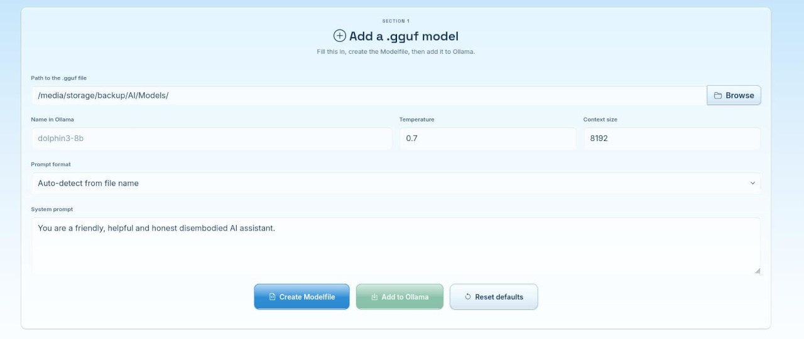

<p align="center">
  
</p>

<h1 align="center">Ollama Manager</h1>

<p align="center">
  A small Flask web app that makes adding, removing and tuning <a href="https://ollama.com">Ollama</a> models painless.<br>
  No more hand-writing Modelfiles.
</p>

---

## What it does

- **Add a .gguf model** by filling in a form. It builds the Modelfile for you, shows a live preview, and adds the model to Ollama behind a progress modal.
- **Prompt formats built in:** auto-detect from the file name, or choose ChatML, Llama 3, Mistral, Gemma, Phi-3, Alpaca, or the template embedded in the GGUF.
- **Browse** the `.gguf` files in your models folder.
- **Installed models:** list, view the Modelfile, copy the name, and remove (with a confirmation dialog).
- **Daemon controls:** start, stop and restart the Ollama service, with a live VRAM progress bar.
- **Timeout and memory:** change how long idle models stay loaded, see what is in memory, and unload a model on demand.
- **Settings:** flash attention, KV cache type, parallel requests and max loaded models.
- **Cheat sheet** of useful Ollama commands with copy buttons, and an activity log of every model added or removed.
- Ten colour themes, large buttons and styled tooltips, built on Bootstrap 5 and Bootstrap Icons.

## Requirements

- Linux with systemd (developed on Lubuntu 22.04)
- [Ollama](https://ollama.com) installed as a systemd service named `ollama`
- Python 3.10+ and Flask (`pip install flask`)
- `zenity`, only if you use `run.sh` (for the password prompt)
- An NVIDIA GPU with `nvidia-smi`, only for the VRAM bar (everything else works without it)

Windows and macOS are not supported. The daemon controls rely on systemd and the launcher on `sudo` and `zenity`, so a port would need a substantial rework.

## Quick start

```bash
git clone <your-repo-url> ollama-manager
cd ollama-manager
./run.sh
```

Then open the address it prints, normally <http://127.0.0.1:5782/>. If port 5782 is busy, the app tries the next free port.

### Two ways to launch

| Command | Daemon start/stop/restart and settings | Everything else |
|---|---|---|
| `./run.sh` | Works. Asks for your sudo password in a dialog, then runs the app as root. | Works |
| `python3 app.py` | Disabled, because the app needs root to control a system service. | Works |

When launched with `run.sh`, files the app creates in `logs/` and `data/` are handed back to your user when it exits.

## Configuration

The constants at the top of `app.py` are meant to be tweaked:

| Constant | Purpose |
|---|---|
| `DEBUG_MODE` | `False` keeps the console quiet. `True` prints request logs and writes extra audit lines to the log file. |
| `PORT`, `PORT_TRIES` | Starting port and how many following ports to try. |
| `DEFAULT_MODELS_DIR` | Where the Browse button looks for `.gguf` files. |
| `DEFAULT_TEMPERATURE`, `DEFAULT_CONTEXT`, `DEFAULT_SYSTEM_PROMPT` | Form defaults. |
| `LOG_MAX_BYTES` | The log is trimmed to its newest half once it exceeds this size (100 KB by default). |

Form values are remembered in your browser's local storage.

## Project layout

```
app.py              entry point and constants
run.sh              launcher with a zenity sudo prompt
assets/
  html/             the single page
  css/              Bootstrap plus modular, token-based CSS and themes
  js/               page logic
  py/               helper modules (functions_*.py) and the root helper
  img/              README image
logs/               ollama_manager.log (created on demand, git-ignored)
data/modelfiles/    generated Modelfiles (created on demand, git-ignored)
```

## Security notes

- The server binds to `127.0.0.1` only and rejects requests whose `Host` header is not localhost.
- Every POST must be JSON, which blocks simple cross-site form posts.
- Model names, paths and settings are validated, and no shell is ever used to run commands.
- Root actions go through a small helper that accepts only `start`, `stop`, `restart` and a whitelist of five Ollama settings.
- Running the app as root is a deliberate convenience. Keep it on a machine and network you trust.

## Notes

- Adding a model only runs `ollama create`. It never loads or runs a model.
- Changing a daemon setting restarts Ollama, which unloads any loaded model. The app asks you to confirm first.
- Settings are written to a systemd drop-in, `/etc/systemd/system/ollama.service.d/zz-manager.conf`.
